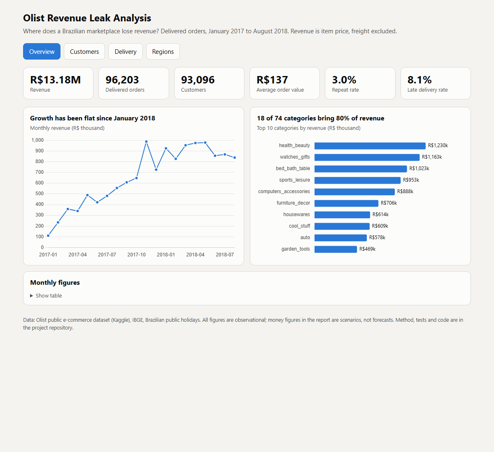
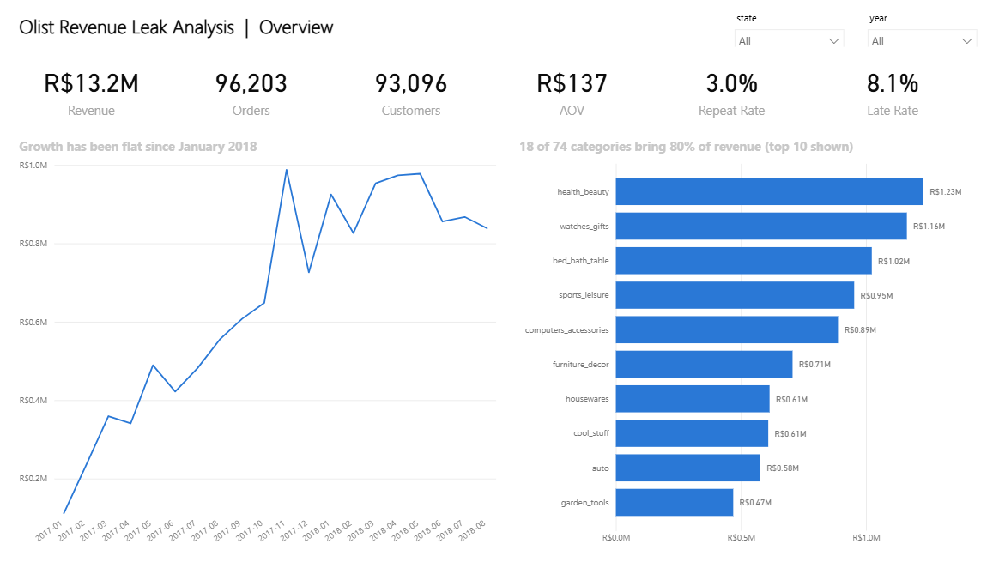
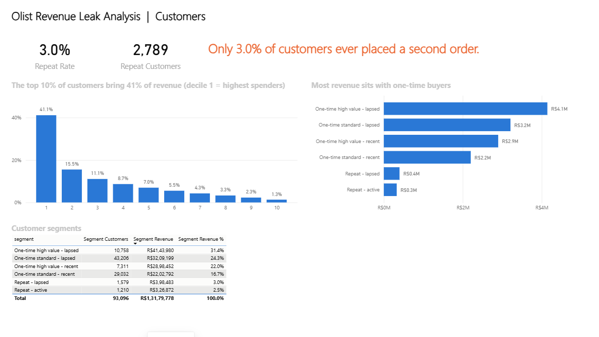
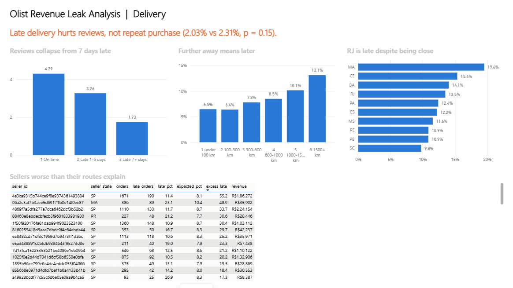
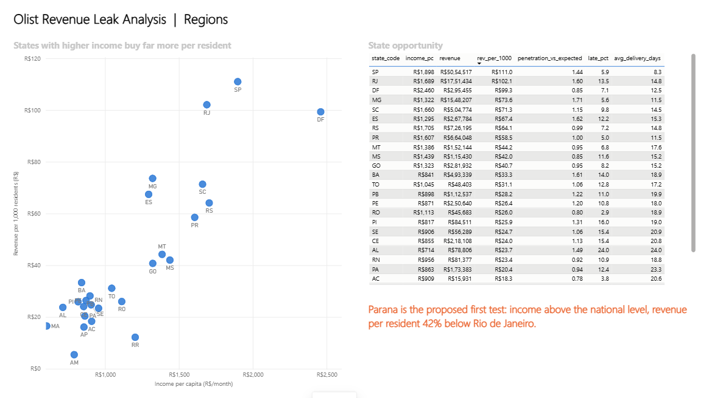
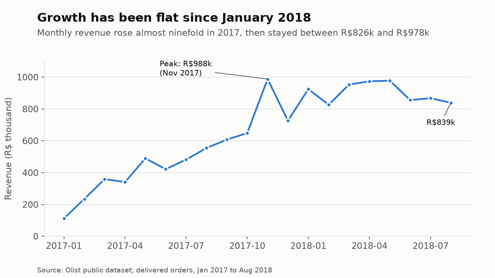
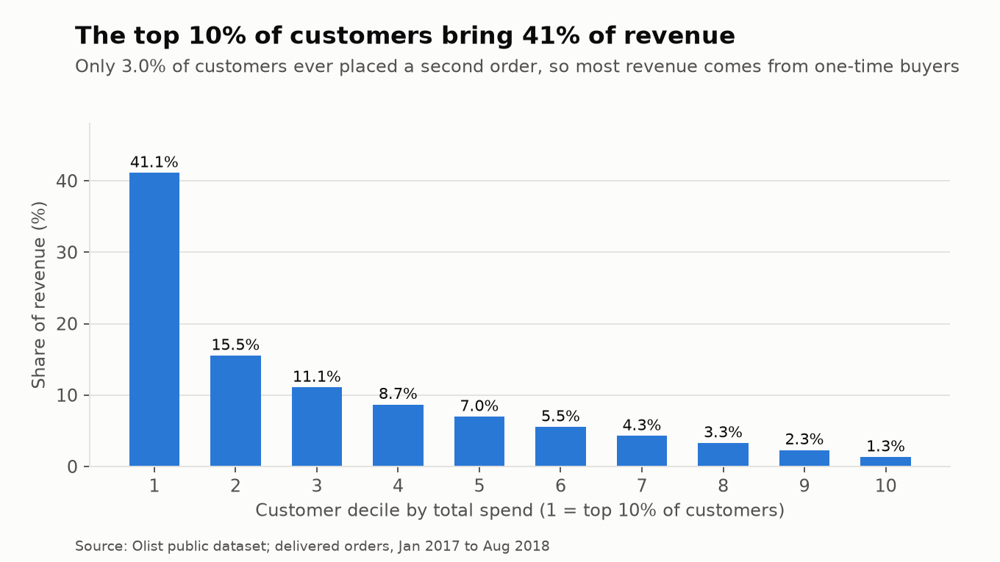
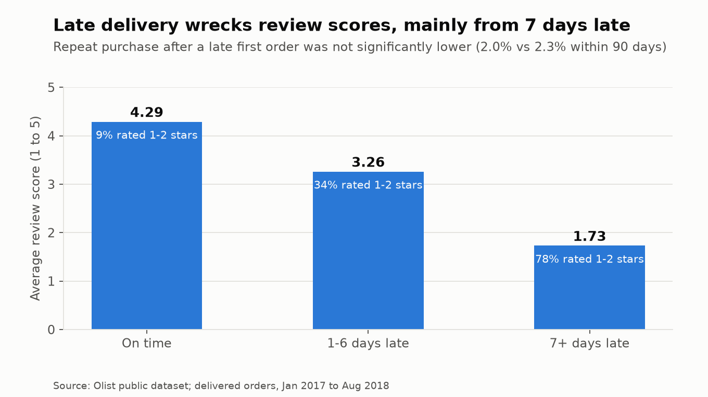
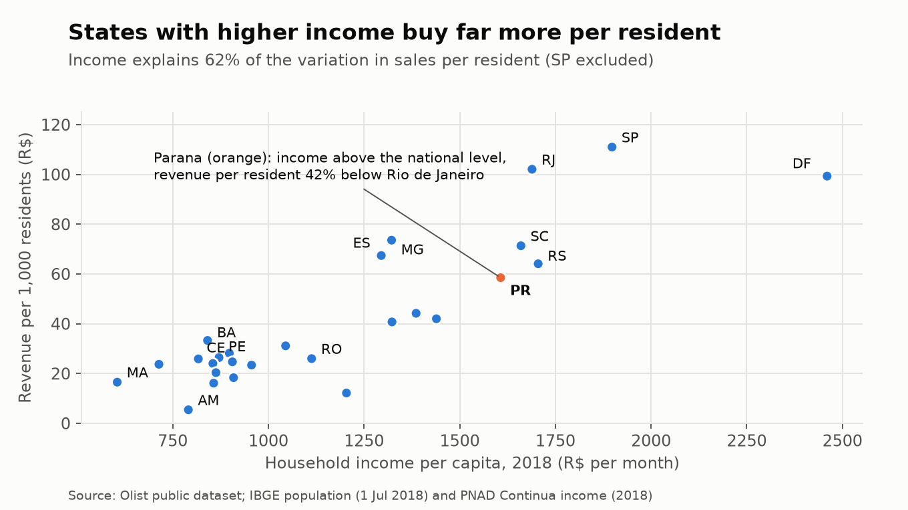

# Olist Revenue Leak Analysis

**Where does a Brazilian online marketplace lose money, and what should it fix first?**
An end-to-end analysis of about 100,000 Olist orders (2016 to 2018), combined with official IBGE state data, using SQL, Python, statistics and a tested data pipeline, with an Excel workbook and a Power BI dashboard for the business teams.

> **Live dashboard:** https://muskanpandey0304.github.io/Olist_Revenue_Leak_Analysis/ *(works once GitHub Pages is turned on, see below)* &nbsp;|&nbsp; **Power BI file:** [`dashboard/powerbi/olist_revenue_leak.pbix`](dashboard/powerbi/olist_revenue_leak.pbix) &nbsp;|&nbsp; **2-minute walkthrough:** *(add the video link here)*



### Power BI dashboard
Four pages built in Power BI Desktop on the same star schema (9 tables, 6 relationships, 16 DAX measures). Open [`olist_revenue_leak.pbix`](dashboard/powerbi/olist_revenue_leak.pbix) in Power BI Desktop; the data is inside the file.

| Overview | Customers |
|---|---|
|  |  |
| **Delivery** | **Regions** |
|  |  |



## The brief
Leadership says growth has levelled off and asks: which customers matter, why do most customers buy only once, is delivery costing us, and are we under-selling in the regions with the most spending power?

## What I found
| Question | Answer |
|---|---|
| Are we growing? | Revenue was **R$13.18M** (96,203 delivered orders, 93,096 customers, Jan 2017 to Aug 2018). It rose ninefold in 2017 and has been **flat since January 2018**. Order value is stable at about R$137, so growth came from volume. |
| Why is growth stuck? | **Only 3.0% of customers ever buy a second time** (2.28% within 90 days, measured on customers who had the full 90 days). Repeat customers spend about twice as much (R$260 vs R$138), but there are very few of them. |
| Who matters? | The top 10% of customers bring 41% of revenue. **7,311 recent high-value one-time customers** (R$2.9M past spend) are the first win-back target. |
| Is late delivery the cause? | **No, and this is the result I did not expect.** Late orders (8.1%) score 2.57 stars against 4.29, and 78% of orders 7+ days late get 1 or 2 stars. But customers whose first order was late came back at about the same rate (2.03% vs 2.31%, p = 0.15). Delivery is a review and reputation problem, not a retention problem. |
| Why are deliveries late? | About 93% of the extra time is **carrier transit**, not seller dispatch. Rio de Janeiro is the outlier (13.5% late at about 394 km, against 5 to 6% in SP, MG and PR). 57 sellers account for 25% of late orders while handling 15% of orders. Holidays do not explain it. |
| Can late orders be predicted? | A logistic regression catches **25% of late orders** (32% of 7+ day late orders) in the riskiest 10% of orders, tested on months it never saw (ROC AUC 0.72). It ranks risk; it is not precise. |
| Where are we under-selling? | Sales per resident follow state income (62% of the variation) and fall where delivery is slow and freight is expensive. If six high-income states reached Rio de Janeiro's level, revenue would be up to **R$1.5M (11.5%)** higher: an upper bound. Paraná is proposed as the first test. |

<p>


</p>


## Recommendations, ranked by money at stake
1. **Test a freight or delivery-promise offer in Paraná**, then RS and SC (up to R$1.5M ceiling for six states; the realistic share is much smaller).
2. **Win back 18,069 high-value one-time customers** with a randomised message (about R$114,500 per extra percentage point of repeat rate).
3. **Fix delivery where it matters:** investigate the RJ carrier, put 57 sellers on a watch-list, recalibrate the padded delivery estimates (on-time orders arrive a median of 14 days early) and flag the riskiest 10% of orders at purchase.

Experiment designs and sample sizes: [reports/experiment_design.md](reports/experiment_design.md). Full write-up: [reports/insights_report.md](reports/insights_report.md). One-page memo to Operations: [reports/stakeholder_memo.md](reports/stakeholder_memo.md).

## How it is built
```
raw files  ->  staging (clean, typed, deduplicated)  ->  star schema  ->  analysis  ->  Excel and Power BI
```
- **Star schema** in SQLite: `fact_orders`, `fact_order_items`, `dim_customer`, `dim_seller`, `dim_product`, `dim_date`.
- **20 automated data quality tests** must pass. Revenue and the late rate are recalculated independently from the raw CSV files and must match; there are no duplicate or lost rows; every fact row has its dimension row; every state matches the IBGE table; the population total matches IBGE's published figure. The tests caught two real bugs during the build (a date column that did not join, and bad GPS coordinates that produced 8,678 km delivery distances).
- **Metric definitions** are fixed before analysis: [reports/metrics_definitions.md](reports/metrics_definitions.md). Every data issue and the decision taken is in [reports/data_quality_log.md](reports/data_quality_log.md).

### Data sources
| Source | Used for |
|---|---|
| [Olist Brazilian E-Commerce Public Dataset (Kaggle)](https://www.kaggle.com/datasets/olistbr/brazilian-ecommerce) | Orders, items, payments, reviews, customers, sellers, products, geolocation |
| IBGE population estimates, 1 July 2018 | Revenue per resident by state |
| IBGE PNAD Contínua 2018, household income per capita | Income by state |
| Brazilian national holidays (`holidays` Python package) | Testing whether holidays delay deliveries |
| Seller-to-customer distance | Derived from Olist geolocation (haversine) |

### Skills shown, and the question that needed each
| Skill | Where | Question it answers |
|---|---|---|
| SQL: joins, CTEs, window functions (`LAG`, `RANK`, `NTILE`, cumulative sums) | `sql/` | Growth, category concentration, cohort retention |
| Data cleaning and validation (pandas, tests) | `pipeline/`, `tests/` | Can the numbers be trusted? |
| Cohort and segment analysis | `sql/40`, `notebooks/03` | Why do customers not return? |
| Hypothesis testing, effect sizes, confidence intervals | `notebooks/04` | Is late delivery really hurting us? |
| Regression and decomposition | `notebooks/05`, `notebooks/07` | What causes lateness; where is the regional gap? |
| Explainable model, time-based validation | `notebooks/06` | Which orders will be late? |
| Experiment design and power calculation | `notebooks/08` | How would we test a fix? |
| Excel (live formulas, charts), Power BI (data model, DAX measures, 4 pages), interactive web dashboard | `excel/`, `dashboard/powerbi/`, `docs/` | How do different teams get the answer? |

## Run it yourself
Requires Python 3.10 or newer.
```
python -m venv .venv
.venv\Scripts\activate            # Windows (Linux/macOS: source .venv/bin/activate)
pip install -r requirements.txt
```
1. Download the Olist dataset from Kaggle (link above) and unzip the 9 CSV files into `data/raw/olist/`.
2. Build everything and run the tests: `python pipeline/run_pipeline.py`
3. Run an analysis stage, for example `python notebooks/04_late_delivery_tests.py`.
4. Export for Power BI and Excel: `python pipeline/30_export_for_bi.py` then `python pipeline/31_build_excel.py`.
5. Rebuild the web dashboard: `python pipeline/32_build_web_dashboard.py` (writes `docs/index.html`).
6. Rebuild the Power BI file: `python pipeline/33_export_powerbi.py`, then `python pipeline/34_build_powerbi_project.py`. Open the generated `dashboard/powerbi/olist_revenue_leak.pbip` in Power BI Desktop, click **Refresh now**, then **Apply changes**. Details in [`dashboard/POWER_BI_BUILD_GUIDE.md`](dashboard/POWER_BI_BUILD_GUIDE.md).

The raw Olist files and the generated database are not in the repository (size); step 1 and 2 recreate them.

## Repository map
```
pipeline/    scripts: load, clean, build the star schema, export
sql/         numbered SQL files, one per question
notebooks/   analysis scripts for each stage (statistics, models, scenarios)
tests/       data quality tests
reports/     findings per stage, metric definitions, data quality log, memo, report, figures
excel/       summary workbook
dashboard/   Power BI file and project (powerbi/), web dashboard template, build guide, summary tables
docs/        the published web dashboard (docs/index.html) and its screenshots
PROJECT_PLAN.md   the plan, decisions log and change log
```

## Limits
Observational data, so no causal claims. The carrier, visit data, margins and commissions are not in the dataset, so costs and break-even points are not estimated. Money figures in the recommendations are scenarios, not forecasts. Customers are identified by `customer_unique_id`; the data ends in August 2018. See section 8 of the [report](reports/insights_report.md).
